# ProfToPdf

**Turn university lecture recordings into structured, editable notes and a readable PDF.**

ProfToPdf is a mobile-first web application with an Italian interface. It prepares audio on the device, transcribes small segments through **Groq Whisper Free**, generates notes and an outline through **OpenAI's native API**, and creates a searchable A4 PDF locally. The approved deployment uses **Vercel Hobby and Upstash Redis Free**, a funded OpenAI account for the primary language model, and two strictly free fallback providers. OpenAI usage is paid and explicitly authorized by the repository owner; this architecture replaces the original entirely free notes workflow.

**Status:** private beta. A fresh **70m52s Samsung S26 / Chrome production lesson** completed all AI work in **8m36s** of recorded activity with **$0.016457** native OpenAI cost and no quota waits, retries or fallback. The owner has now confirmed correctly formatted PDFs, visible formulas, and a successful PDF from three M4A recordings. Revision **v11** improves incremental audio selection, M4A duration detection and remembered picker location. These new controls still require a deployed device test; Apple acceptance and full academic fidelity review remain open.

## Capabilities

- Add recordings progressively to one lesson, with date/name sorting for each new group, preserved manual order, individual removal and total duration. Drag-and-drop and remembered picker location are available where the browser supports them.
- A lesson library, editable title, optional subject, and daily quota bars separating used and reserved capacity.
- Local audio preparation, progress by phase, quota countdowns, pause/resume, and IndexedDB persistence.
- Screen Wake Lock during foreground processing and PDF generation, with clear fallback messages and automatic release on pause.
- Timestamped transcript export, structured notes, Markdown editing, chapters, key concepts and a glossary.
- Selectable PDF text, embedded local fonts, page numbers, a contents list, and support for accents and polytonic Greek glyphs.
- Local LaTeX mathematical typesetting for fractions, indices, integrals, vectors and matrices; adaptive spacing and headings kept with following text prevent orphan titles.
- Android installation prompt when available; contextual Safari installation instructions shown only on request.
- Confirmed lesson deletion, diagnostic JSON export, and cumulative processing times next to the PDF download.

The application accepts up to **50 recordings totalling 120 MB / 120 minutes per lesson**. These are enforced limits, not a claim that every device and codec combination has passed a two-hour test.

## Architecture

```mermaid
flowchart LR
    A[Ordered audio files on device] --> B[Local segments and virtual timeline]
    B --> C[IndexedDB: segments and progress]
    C --> D[Vercel: one small audio request]
    D <--> Q[Upstash: session, atomic quotas, short cache]
    D --> E[Groq Whisper]
    E --> F[Local timestamped transcript]
    F --> G[Persisted text batches]
    G --> H[Vercel: one notes or outline request]
    H <--> Q
    H --> I[OpenAI: GPT-6 Luna]
    I -. definitive failure .-> R[Groq: GPT-OSS Free]
    R -. wait over 15 min or definitive service failure .-> O[OpenRouter: Dots Free]
    I --> J[Local editable document]
    O --> J
    R --> J
    J --> K[PDF worker and downloads]
```



The **original recording never passes through a Vercel Function**. The browser sends independently decodable segments below 3,200,000 bytes; the server validates their actual format and duration before reserving quota. This stays below Vercel's [4.5 MB Function payload limit](https://vercel.com/docs/functions/limitations) without introducing remote audio storage.

The browser runs a sequential queue. Each Function handles one segment or text unit. Quota waits happen on the device after the Function returns. Speech waits beyond two minutes save and pause; notes waits up to fifteen minutes resume automatically while visible, and longer waits save and pause if no alternative is available; no background server process is kept alive for the duration of a lecture.

| Component                 | Implementation                                                                                          |
| ------------------------- | ------------------------------------------------------------------------------------------------------- |
| Application               | Next.js App Router, React, TypeScript, Tailwind CSS                                                     |
| MP3 / PCM WAV preparation | Incremental TypeScript parsing; no FFmpeg download for standard supported files                         |
| Other audio formats       | FFmpeg.wasm, single-thread worker, WORKERFS; remux or bounded per-segment conversion                    |
| Speech recognition        | `whisper-large-v3-turbo`; explicit `whisper-large-v3` recovery                                          |
| Notes and outline         | Native `gpt-6-luna` -> Groq `openai/gpt-oss-120b` -> conditional `dots-studio/dots-3-note-preview:free` |
| Token budgeting           | Local `js-tiktoken`, o200k ranks, conservative framing margin and full completion allowance             |
| Persistence               | IndexedDB for lessons and text; localStorage for bounded diagnostics                                    |
| Coordination              | Upstash Redis, atomic Lua reservations and local cross-tab leases                                       |
| PDF                       | PDF-LIB and fontkit in a terminable worker; Noto Sans plus on-demand Noto Sans Math                     |

## Provider routing and operating budgets

Only the native OpenAI primary incurs model charges. Keep Groq, OpenRouter and infrastructure on their free plans. OpenRouter requests are pinned to the approved `:free` model, with `reasoning: { enabled: false }`, `provider.data_collection: "deny"`, required parameter support and maximum prompt/completion/request prices of zero. There is no paid OpenRouter fallback or automatic billing upgrade. Provider access, terms and actual account limits must still be checked when provisioning an installation.

OpenAI uses the official `openai` SDK and Responses API with `model: "gpt-6-luna"`, `reasoning: { mode: "standard", effort: "medium" }`, strict JSON Schema and `store: false`. All three providers share the same prompt, schema and content validator. Output allowances include reasoning tokens: up to 12,000 for a 30-source native notes batch and 6,000 for the outline. See the official [GPT-6 Luna model](https://developers.openai.com/api/docs/models/gpt-6-luna) and [Structured Outputs](https://developers.openai.com/api/docs/guides/structured-outputs).

The router persists its provider and at most one upstream call per Function invocation. The priority is **OpenAI -> Groq -> OpenRouter**:

- Received OpenAI credit, authentication, rate-limit or service failures advance to Groq.
- A Groq quota/cooldown wait of **60-90 seconds, or any wait up to exactly 900 seconds**, stays with Groq. The client displays a countdown; no Function sleeps. Local quota denial starts no inference and consumes no retry leg. A received Groq 429 is cached; the next safe retry gets a new Groq leg without returning to paid OpenAI.
- OpenRouter is used **only if Groq's estimated wait is greater than 900 seconds**, or Groq returns a definitive service/authentication/model-access failure or is unconfigured. This includes a received HTTP 5xx response; an unknown outcome or network timeout still requires recovery rather than automatic duplication.

HTTP 202 continues the **same logical operation and attempt** after rerouting. All providers use one schema and validator. Invalid content follows bounded repair. Three full rounds of rejected cascading bound an operation; Groq minute-level quota waits stay at Groq instead of consuming full cascade rounds. Operation/cache IDs remain stable across this policy change, including pending legacy operations. The new policy has its own persisted version; a previous notes-only wait is reassessed once, retaining batch IDs, attempts and confirmed text. STT waits and shared counters are retained.

The application defaults are independent for each provider:

| Provider            | Application ceiling                                                       | Meaning                                                                               |
| ------------------- | ------------------------------------------------------------------------- | ------------------------------------------------------------------------------------- |
| OpenAI native       | 1,000,000 tokens/minute; **$1.00/rolling 24h**, **$0.25/job/rolling 24h** | Conservative reservations, settled to verified cost; not the account's credit balance |
| OpenRouter Free     | 15 requests/minute; 45/rolling 24h                                        | Margin below the uncredited account's 20/minute and 50/day limits                     |
| Groq notes fallback | 6,000 tokens/minute; 160,000/rolling 24h; 20 requests/minute; 800/24h     | Existing free-plan safeguards retained                                                |
| Groq speech         | 6,600 audio seconds/hour; 27,000/24h; 15 requests/minute; 1,500/24h       | Existing speech pipeline and counters unchanged                                       |

The OpenAI TPM setting is an application ceiling, **not a verified Tier 1 entitlement**; account-specific provider limits can still produce a 429 and trigger fallback. Budget reservations include the maximum output allowance, so capacity must cover the next complete reservation. The UI shows separate daily provider bars, distinguishing used and reserved capacity; the OpenAI bar is an application budget, not a live billing balance. OpenAI credit exhaustion is detected from provider responses.

These are **shared rolling windows**, not per-student allocations or midnight resets. Overlap, new attempts and processing outside this application consume provider capacity. The quota bars cannot see external calls. A provider rejection introduces a cooldown scoped to that provider; Groq speech and notes remain separate. Groq limits apply at organization level; extra keys in the same organization do not increase capacity. See [Groq rate limits](https://console.groq.com/docs/rate-limits), [billing information](https://console.groq.com/docs/billing-faqs), and [OpenRouter limits](https://openrouter.ai/docs/api-reference/limits).

The remaining quota must cover the **whole next reservation**, not merely be greater than zero. A green availability indicator is not a guarantee that an entire lecture fits. No quota is cleared to make a job appear successful.

Atomic reservations use Redis TIME and are reconciled against confirmed provider usage. Text reservations count prompt and schema tokens, add 20% plus 512 tokens for framing/provider differences, and include the full completion budget. Native cost accounting uses the published Standard prices: **$0.10/M input, $0.01/M cached input, $0.50/M output**, including output reasoning. Charges are estimated from returned usage, not invoiced amounts. A definitive pre-generation rejection releases the OpenAI monetary reservation; an attempted OpenRouter request still counts as a request. Unverified usage and ambiguous failures retain reservations. SDK retries are disabled.

New native/OpenRouter notes batches allow **30 sources and a JSON body below 60 KB**, with a server limit of 64 KB. They do not inherit Groq's 6,000 TPM restriction or minute-long pacing. If a large unit reaches Groq, the router first checks cooldown and the quota for a feasible small request, without reserving tokens. A prolonged block routes the intact large unit to OpenRouter; otherwise it requests rebatching **before inference**; the browser persists smaller units targeting a **5,500-token** reservation and a body below 14 KB. Confirmed and ambiguous units retain their identities. The wire contract stays stable while the server migrates policy state; reload to obtain the multi-audio interface. Do not lower a custom minute allowance without checking that a single fallback unit fits.

Upstash Free currently advertises 250 MB and 500,000 commands/month. The bounded response cache holds at most 500 results of up to 48 KB, with a 15-minute TTL; Redis stores no audio. Monitor [Upstash usage](https://upstash.com/pricing/redis) and [Vercel Hobby usage](https://vercel.com/docs/plans/hobby) separately. Monthly infrastructure capacity is not represented fully by the application's daily AI bars. Hobby is intended for personal, non-commercial use.

## Setup and deployment

Requirements: **Node.js 22.x**, npm, Vercel Hobby with Fluid Compute enabled, Groq Free credentials, Upstash Redis Free, a funded OpenAI account and OpenRouter Free credentials. Missing optional OpenAI/OpenRouter keys skip those providers; the deployed architecture expects both.

1. For a **new environment**, copy [config/environment.example](config/environment.example) to `.env`. Never overwrite an existing configured `.env`.
2. Supply server-only credentials and an exact HTTPS `APP_ORIGIN`. Use a strong access password and a randomly generated session secret of at least 32 characters.
3. Run the local code checks and production build:

   ```text
   npm ci
   npm run check
   npm test
   npm run build
   ```

4. Add the same environment variables in Vercel. Use **Install: `npm ci`**, **Build: `npm run build`**, **Node: 22.x**, and Fluid Compute. Keep development dependencies available during the build: esbuild generates the PDF worker.
5. Enable `AI_ENABLED=true` only after verifying native OpenAI credit/access and the free providers' limits. `AI_ENABLED=false` blocks new operations for every provider. Deploy through the repository owner's normal Vercel workflow, then perform the production acceptance checks below. Never replace an already configured `.env` with the template.

| Variable                                                        | Purpose                                                                    |
| --------------------------------------------------------------- | -------------------------------------------------------------------------- |
| `GROQ_API_KEY`                                                  | Private Groq credential                                                    |
| `OPENAI_API_KEY`                                                | Private native OpenAI credential; primary paid notes/outline               |
| `OPENROUTER_API_KEY`                                            | Private credential for the strictly free prolonged-block fallback          |
| `UPSTASH_REDIS_REST_URL`, `UPSTASH_REDIS_REST_TOKEN`            | Private Redis connection                                                   |
| `SESSION_SECRET`                                                | Session signature secret, minimum 32 characters                            |
| `APP_ACCESS_PASSWORD`                                           | Shared invitation password, minimum 8 characters                           |
| `APP_ORIGIN`                                                    | Exact HTTPS origin, without a trailing slash or path                       |
| `AI_ENABLED`                                                    | `false` by default; gates new AI operations                                |
| `GROQ_STT_MODEL`, `GROQ_NOTES_MODEL`                            | Allowlisted model selection                                                |
| `OPENAI_TOKENS_PER_MINUTE`                                      | Native app TPM ceiling; default 1,000,000, maximum 2,000,000               |
| `OPENAI_BUDGET_MICRO_USD_PER_24H`                               | Shared native app cost ceiling; default 1,000,000 micro-USD ($1)           |
| `OPENAI_BUDGET_MICRO_USD_PER_JOB`                               | Native job cost ceiling per rolling 24h; default 250,000 micro-USD ($0.25) |
| `OPENROUTER_REQUESTS_PER_MINUTE`, `OPENROUTER_REQUESTS_PER_24H` | Free request guards; defaults 15 and 45, hard maxima 20 and 50             |

The template also lists bounded audio and quota settings. There are no browser-exposed API keys and no required `vercel.json`. AI routes use Node.js, `maxDuration=120`, a shorter upstream timeout, and one operation per invocation.

`prebuild` generates `public/ffmpeg/` and `public/pdf/`; both must stay untracked. Commit their source scripts, the lockfile, and the local font assets instead. WASM is served as `application/wasm`; FFmpeg assets are versioned, and PDF worker/service-worker assets are revalidated. Font downloads are not required during deployment.

The mathematical fallback is **`public/fonts/NotoSansMath-Regular.ttf`**, served from the application origin and fetched only when the two text fonts lack a requested character. Include this binary and **`public/fonts/OFL-NotoSansMath.txt`** in the owner's commit; prebuild checks font assets before generating the worker. Symbols retain their original code points in headings, body text, glossary and running headers, including mixed-font words and bold passages. No compatibility normalization removes mathematical styles or superscripts, and saved Markdown is not rewritten. A character absent from all fonts still produces an explicit diagnostic.

Font provenance: [Google Fonts source, pinned revision](https://github.com/google/fonts/tree/dbd1ab6e65dc59bcda3ca8de9fd372f58f98e0af/ofl/notosansmath), SIL OFL 1.1; 1,015,396 bytes, SHA-256 `3f495fe933c06786e4d5f6d86b8ee70b6753a68ee3b9d87528726de0f6e2c47d`. This adds a font asset, not an external runtime service.

Mathematics uses **MathJax 3.2.2**, pinned for its self-contained SVG output, with the base and AMS packages. The worker loads its local math chunk only when a delimited expression is present. TeX is protected before Markdown processing, composed into vector paths and fraction bars, and positioned using its real height/depth. Both inline `\(...\)` / `$...$` and display `\[...\]` / `$$...$$` are supported, with safeguards for literal prices. Original notes/Markdown are preserved. Compatible PDF readers can copy the original LaTeX source through `ActualText`; prose remains ordinary searchable text. A copied formula may therefore contain TeX source even though the visible PDF shows the composed equation.

There is no remote rendering, HTML execution, package autoloading or additional API cost. Bounds cover expression size/count, macro expansion, path count and page dimensions; malformed or unsupported notation produces a specific PDF error. New-model prompts request the same supported notation. This is a mathematical subset rather than a complete LaTeX document compiler. See [MathJax SVG output](https://docs.mathjax.org/en/v3.2/options/output/svg.html) and [TeX processor options](https://docs.mathjax.org/en/v3.2/options/input/tex.html). Commit `package.json`, `package-lock.json`, source changes and the build script; generated `public/pdf/` chunks remain ignored and are rebuilt on Vercel.

On Windows, use `npm.cmd` if PowerShell blocks `npm.ps1`. This workspace follows **Direct-to-Cloud**: local compilation/checks, owner-managed commit/push, then browser testing on the deployed HTTPS origin. Only the repository owner runs Git commands; agents do not start local preview servers.

## Using ProfToPdf

1. Sign in and choose **Nuova lezione** from **Le tue lezioni**. Select one or more recordings. Use **+ Aggiungi registrazioni** to add further files without replacing the selection, check their sequence, enter a useful title, optionally choose or type a subject, and press **Prepara la lezione**.
2. When segmentation finishes, press **Trascrivi e crea il Pdf**. Keep the application visible. Where supported, the screen stays awake automatically. Progress and quota waits appear in the processing panel; confirmed results are saved after every unit.
3. Review the transcript and notes. Edit the Markdown if needed, save it, and press **Prepara PDF**. Download or open the generated file in the device's PDF viewer.
4. Export important material before deleting a lesson or clearing browser storage. Deletion requires confirmation and interrupts local processing; an already submitted provider request can still consume quota.

The first PDF line contains **Subject - dd/mm/yyyy**, followed by the lesson title on the next line. The filename uses `Subject - Title - dd-mm-yyyy.pdf`, omitting an empty subject. Slashes are replaced with hyphens for filesystem compatibility. Dates use Europe/Rome. PDF regeneration requires confirmation when an earlier export is recorded; changing saved notes permits a new version.

### Adding recordings

Each newly selected group sorts by **`lastModified` ascending**, then natural filename order (`part2` before `part10`). Additional groups append to the existing list, preserving any manual corrections. The modification date is supplied by the operating system, not a guaranteed original recording date. Each row shows its sequence, filename, duration and date, with up/down and remove controls. Re-selecting a file with the same name, size and modification date skips that metadata duplicate and shows a notice; this convenience check is not a content hash. Combined limits are checked before changing the existing selection.

M4A/MP4 duration is read locally from ISO BMFF metadata, including headers at the end of the file, 32/64-bit durations and generic/empty MIME types. The reader skips the media payload and uses bounded header reads; no full-file decoding or FFmpeg is needed for the preview. WAV/MP3 retain their incremental readers. Other/unsupported containers fall back to browser metadata, with timeout and safe diagnostics; an unavailable duration is verified during preparation. Preview duration is a hint, not the server's trusted quota measurement.

### Finding recordings and remembering the folder

Samsung documents **Archivio -> Memoria interna -> Recordings -> Voice Recorder** for Voice Recorder files; the owner also confirmed this location through ProfToPdf on the S26. An expandable in-app guide and **Sfoglia tutti i file** let users bypass an audio MIME filter. If a provider hides recordings, copy them locally to Download using Samsung Archivio; cloud upload/download is unnecessary. See [Samsung Voice Recorder help](https://www.samsung.com/it/support/mobile-devices/how-to-record-play-back-and-share-voice-recordings-on-your-samsung-galaxy-phone/).

When `showOpenFilePicker` exists, both picker modes use the same stable ID, `proftopdf-recordings`, and the last selected file handle as `startIn` while the page is open. The browser manages remembered directories across sessions; the app retains no absolute path and requests no write access. Unsupported browsers use the normal file input, whose initial folder is controlled by the browser/OS. Remembered location is therefore capability-dependent, not guaranteed on every Chrome/Android/Safari combination. Cancellation keeps the selection and previous handle; missing locations clear the stale hint, and errors offer an explicit standard-picker button. See [Chrome's picker location and ID documentation](https://developer.chrome.com/docs/capabilities/web-apis/file-system-access#specifying-the-purpose-of-different-file-pickers).

### Virtual timeline and resume

The browser checks the ordered originals and total duration, then segments **one recording at a time**. It never combines the original files into a large buffer. A second recording begins at the first recording's duration, the third at the sum of the first two, and so on. Global chunk indices and shifted timestamps feed the unchanged Whisper endpoint and one continuous notes plan, outline and PDF. Decoder overlap is retained within a recording; unrelated parts have no overlap and no boundary text deduplication. Intervals during which nobody recorded are not inserted as artificial silence.

Original checksums, part durations/offsets and global chunks are checkpointed in IndexedDB. Optional `manifest.sources` and `chunk.sourcePartIndex` extend version 1 without a database migration; old one-file lessons keep their original fingerprint and remain valid. Resume missing audio by selecting **all originals in the saved order**. Changed OS dates/names do not invalidate matching ordered content. After segments are present, no original reselection is needed. A checkpoint includes part metadata and boundaries, not audio or notes. The preflight and preparation use at most one audio engine at a time; compressed fallback formats may require reopening that engine after metadata validation.

Headings are measured with their actual wrapped lines and mathematical heights. A title that would occupy the last two body lines moves to the next page with following text, leaving whitespace. Consecutive headings and the paragraph widow rule are handled together. Existing lessons can regenerate just the PDF, without repeating paid AI work. `pdf.layout.complete` reports the page count and the number of headings moved.

Android installation uses the native browser prompt when it becomes available. Safari instructions open after tapping **Installa ProfToPdf**. Installed/standalone detection hides the control; Safari's manual **Ho aggiunto l’app alla Home** confirmation handles the normal-tab detection limitation. Installation does not enable offline AI or background processing. Apple may keep the installed app's storage separate from Safari.

## Recovery and error handling

Use **Riprendi / recupera il risultato** on the same device and browser. Confirmed transcripts and notes are reused. A saved batch plan keeps operation IDs stable across reloads; upgrades preserve confirmed legacy notes and the legacy operation being repaired.

The notes response has a **required object entry for every source**. The model supplies that source's paragraphs, bullets and concepts; each entry must contain nonblank substantive content. The application assembles one section per batch and attaches source references only after checking every entry. Missing or empty entries remain errors. Speech-uncertainty warnings are added deterministically. This removes repeated failures caused by omitted citation IDs without accepting absent content or claiming that schema compliance proves academic accuracy.

Definitively invalid notes still receive a corrective attempt within **three total attempts per operation**, with each attempt persisted and quota-reserved. Prompt/schema changes resize only untouched work and locally quota-denied operations that never started. Confirmed notes and ambiguous operations keep their IDs and are not regenerated.

After exhausted coverage/JSON attempts, or immediately for a truncated/oversized completion, a batch containing multiple sources can be split **once into two smaller operations**. The split and child IDs are saved before requests start, confirmed notes are preserved, and children cannot split recursively. Each child has its own quota-reserved attempts; the three-attempt ceiling applies per operation, not to the entire original group. A single-source failure or an unsuccessful child stops visibly. Provider JSON-generation failures are distinguished from rejected audio.

Network ambiguity follows a different path: the application retrieves the **same operation** rather than silently launching another inference. If the result remains unavailable, a new attempt requires an explicit user action. The 15-minute cache and idempotency controls do not provide an unconditional exactly-once guarantee after lost responses or cache expiry.

Speech quota waits up to two minutes resume automatically. Notes waits up to fifteen minutes resume automatically while visible; a longer Groq wait triggers OpenRouter first. If the cascade still cannot proceed, longer waits checkpoint the job, show the retry date/time and pause; the screen lock is released and the app can be closed. Sign in again if needed and resume on the same device/browser after capacity returns. This does not refund earlier consumption or guarantee capacity if another request uses it first.

[Screen Wake Lock](https://developer.mozilla.org/en-US/docs/Web/API/Screen_Wake_Lock_API) requires HTTPS and a visible active page. The app requests it during audio/AI work and PDF rendering, releases it on stop/cleanup, and reacquires it on return to visibility when work is still active. Feature detection, rejection and OS revocation are logged. Power saving, low battery and operating-system policies may deny or revoke it; manual locking or switching apps can still suspend processing. The UI reports when the lock is unavailable.

Whisper V3 recovery is explicit and shares the speech budget. Skipping a failed segment is also explicit: it remains a visible gap, the document is marked partial, and the segment can be recovered later.

The exported **checkpoint contains audio metadata only**. It does not contain audio blobs, transcript or notes, and is not a complete backup. Use transcript TXT, notes Markdown and PDF exports for portable results. Original audio may be required to rebuild missing local chunks. Logout does not erase the local lesson library.

## Diagnostics and timing

**Scarica log diagnostico** exports a JSON report containing client revision, browser/device details, technical progress events, quota waits, error codes and safe validation diagnostics. For example, an invalid field can identify `sections.0.paragraphs` and the expected type without copying the model's response. Coverage failures report separate counts and numeric paths for missing sources, empty citation lists and unknown references; unexpected ID values are excluded. `notes.split` records bounded recovery, and `notes.saved` includes source/uncertainty counts. `inference.usage` records reserved and confirmed token counts; quota errors identify the blocking window and required/residual capacity. `quota.long-pause` records a saved long wait; `wake.*` events record lock acquisition, denial and release.

Logs exclude credentials, cookies, recording contents, transcript text, titles and filenames. They are never uploaded automatically. Retention is five lessons and 200 events per lesson, with an additional size bound; `droppedEvents` records trimming. The current client revision is **`audio-picker-m4a-2026-10-17-v11`**. Console events use `[ProfToPdf audio]`. `llm.reroute` identifies the next provider, `notes.rebatch` records Groq-compatible replanning, and `inference.usage` includes the provider path and calculated cost in micro-USD. PDF diagnostics add `pdf.font.loading` / `pdf.font.fallback` with font name and bounded Unicode counts, plus `pdf.math.loading` / `pdf.math.complete` with expression/cache/vector counts. `timeline.part.start` / `timeline.part.complete` record part indices and cumulative offsets without filenames. `pdf.layout.complete` records page and moved-heading counts. `selection.metadata` records the selected picker mode, whether directory memory was requested, the duration engine, read counts and safe error codes after preparation starts. No filename/path is included. Mathematical errors expose a safe cause or expression ordinal, never the formula or raw library error.

Exports also contain `aiUsageSummary`: `confirmedTokens`, `reservedUnverifiedTokens`, `trackedOperations` and `historyComplete`, plus `confirmedCostUsd`, `costHistoryComplete` and a provider breakdown when available. Each logical operation retains its provider legs, including verified failed-generation usage. Known fallback consumption remains visible even if an earlier leg is uncertain. The per-operation ledger lives with the IndexedDB lesson and survives event trimming; cache replay of the same operation/attempt does not count twice. Old lessons are explicitly marked as incomplete history because earlier usage and costs cannot be reconstructed reliably.

Every export ends with `timingSummary`:

```json
{
  "tempoTotaleSecondi": 153.1,
  "tempoTotaleFormattato": "2m 33s",
  "preparazioneAudioSecondi": 3.3,
  "trascrizioneAppuntiSecondi": 146.3,
  "generazionePdfSecondi": 3.5,
  "completo": true,
  "inCorso": false
}
```

This example illustrates the format, not a 70-minute performance promise. Totals include quota waits during active processing, failed attempts and subsequent PDF regeneration. They exclude manual gaps between commands, paused intervals (including automatic long-quota pauses) and time with the page closed. Thus it measures cumulative processing activity, not calendar time from the first click to the eventual download; a 12-hour quota pause remains a 12-hour practical delay. Timing counters survive event trimming; incomplete historical evidence is labelled partial. Export the diagnostic log before retrying after a failure.

## Validation

As of **17 October 2026**, **139 local automated tests** pass, along with TypeScript/configuration/credential checks and the production build. Coverage includes the strict 15-minute boundary, persistence after a Groq 429, safe policy migration, ordering and offsets, multi-file preparation/resume and checkpoints, repeated speech across part boundaries, one continuous transcript/notes/outline, legacy single-file jobs, and PDF pagination with three-line paragraphs, consecutive/wrapped headings and tall equations. New regressions cover incremental selections, combined limits, duplicate notices, remembered location/cancellation, M4A metadata layouts and malformed bounds, and browser metadata cleanup. Tests do not call inference providers.

| Evidence                                | Verified                                                                                                                                                  | Still required                                                                                                                   |
| --------------------------------------- | --------------------------------------------------------------------------------------------------------------------------------------------------------- | -------------------------------------------------------------------------------------------------------------------------------- |
| Samsung S26 / Chrome production         | 70m52s; 33 transcripts, nine notes calls and one outline; 61,072 LLM tokens; $0.016457; 8m36s recorded activity; later 16-page PDF export                 | v11 incremental additions, folder memory and duration preview; full academic fidelity review                                                      |
| Provider discovery and synthetic probes | Previously confirmed native Luna strict schema/reasoning, Dots free schema/routing and Groq integrations                                                  | These probes are text samples, not new multi-audio device tests                                                                  |
| Redis integration, v10                  | 12 concurrent claims, one winner; Groq short-wait provider/leg survives release; fingerprint conflict, expired started lock and deletion remain protected | Real multi-tab and deployed fallback acceptance                                                                                  |
| Multi-audio local integration           | Sequential WAV preparation, pause/resume, offsets, checkpoints, one transcript/notes plan/outline/document and replay without new calls                   | Mobile mixed-codec recordings and long multi-audio lesson                                                                        |
| PDF worker, v10                         | Actual generated worker: orphan-heading fixture, full 13-page layout, and all 36 formulas extracted from the real PDF                                     | Owner confirmed the production PDF; Apple export/opening and academic review remain                                                         |
| Owner follow-up, v10                    | PDF formatting/formulas confirmed; three M4A parts produced the correct PDF; Samsung recording folder found in-app                                        | v11 incremental additions, remembered location and preview durations on those recordings                                         |
| M4A metadata, local integration         | Three FFmpeg-generated AAC/M4A containers, metadata at front/end and 3gp4 brand: 13.37s exactly, 158 header bytes read per file, matching ffprobe         | Original Samsung recordings and Apple files in deployed browsers                                                                 |
| Apple / capacity                        | Implementation and local checks                                                                                                                           | Safari/iPad installation, wake lock, M4A/AAC, suspension, storage, downloads; two-hour/90 MB and monthly infrastructure capacity |

The real long-test log measured **47.2s preparation, 466.2s transcription/notes and 2.1s for the initial PDF attempt**, totalling **515.5s / 8m36s** active work. The first export failed on a font glyph; the later PDF was successfully supplied by the owner, but its export duration is absent from that earlier log. No quota pauses occurred. Manual gaps between buttons are excluded; calendar time to the initial export attempt was approximately 9m11s.

The earlier synthetic planning range of **8-15 minutes** for 70 minutes of audio is consistent with this one real AI run, assuming sufficient funded primary capacity and no quota waits. It is not a guarantee for every recording/device. Multi-file preflight, PDF mathematics and mobile runtime need new measurements. Free fallback can still exceed 30 minutes if both providers lack capacity. No additional AI calls or charges were incurred for v10 checks.

The measured native cost was **below $0.02** for that lesson. A conservative planning allowance from the earlier synthetic maximum-output benchmark remains **$0.02-$0.06 per 70-minute lesson**, before tax/currency conversion and excluding retries; that benchmark reserved around $0.061. Actual content, reasoning and output length vary. Application budget bars do not infer an account balance or costs incurred by other clients.

Useful commands:

| Command                           | Effect                                                                                                                      |
| --------------------------------- | --------------------------------------------------------------------------------------------------------------------------- |
| `npm run check`                   | TypeScript, environment validation and credential/exclusion checks                                                          |
| `npm test`                        | Local automated suite; no provider calls                                                                                    |
| `npm run build`                   | Production build and generated assets                                                                                       |
| `npm run benchmark:notes`         | Synthetic 70-minute text batch counts; local only                                                                           |
| `npm run benchmark:llm-cascade`   | New primary's synthetic plan, reservation/cost ceiling and explicitly extrapolated timings; local only                      |
| `npm run verify:openai`           | **Paid OpenAI call:** exact model discovery and a small strict-schema synthetic text response                               |
| `npm run verify:llm-cascade`      | **Paid OpenAI + real Redis:** 30 synthetic sources, outline and cache replay; two calls                                     |
| `npm run verify:llm-locks`        | Real Redis, isolated synthetic keys: concurrent claims, persisted routing, ambiguity and deletion; no inference             |
| `npm run inspect:quota`           | Read-only live application quota audit, aggregated without operation IDs; no provider inference                             |
| `npm run verify:source-contract`  | **Uses real Groq/Redis quota:** one small two-source text request and cache replay, with capacity preflight                 |
| `npm run verify:notes`            | **Uses real Groq/Redis quota:** diverse synthetic physics sources, uncertainty, bounded splitting, outline and cache replay |
| `npm run verify:processing`       | **Uses real Groq/Redis quota:** requires a locally supplied short synthetic spoken WAV                                      |
| `npm run verify:audio-metadata`   | Local generated AAC/M4A tones compared with ffprobe; no browser, provider or private recording                              |
| `npm run verify:audio-validation` | Native FFmpeg format validation with generated tones                                                                        |
| `npm run verify:pdf`              | Synthetic PDF worker verification; no browser or API                                                                        |

Cloud checks require a configured private `.env`. Do not repeatedly consume quota for already-passing checks. Test outputs and the operational plan remain local and excluded; this README contains the public setup and acceptance instructions.

## Production acceptance checks

1. Deploy the revision, reload the HTTPS application, sign in and inspect remaining quotas. After starting/resuming processing, confirm the new diagnostic revision above; a previously exported log retains its older revision.
   For the v7 U+1D4CF failure, open the **existing completed lesson and click only “Prepara PDF”**. Transcripts, notes and outline are already saved: there is no need to rerun paid generation or re-upload the audio. Confirm the current log revision, math-font fallback event, successful download and the original symbol in the PDF. Keep browser storage intact.
   For the v8 raw-LaTeX and orphan-heading cases, use the same lesson and **Prepara PDF** again, confirming the existing regeneration dialog. Confirm the **v11** log, `pdf.math.complete`, visibly composed fractions/scripts/integrals, headings kept with following text, preserved text and successful download. No new audio or OpenAI request is needed. Do not infer a failed conversion merely because copying an equation returns its structured LaTeX source.
2. **Test the new multi-audio path.** Create a lesson with two or three short recordings, including one MP3/WAV and one supported phone codec. Select one file, add two more in separate selections, verify durations/total and retained order, then move/remove parts. Reopen the picker and check the remembered folder where supported; cancel once and confirm the list is retained. Confirm continuous timestamps at the joins, one outline/PDF, pause/reload/resume, and an old single-file lesson still working. A longer multi-part test follows after the short case succeeds.
3. For a separate full-duration measurement, create a **new lesson from the original recording** with sufficient speech and native budgets. Avoid manual pauses, export the log, verify provider usage/cost and compare the full transcript/PDF to the source. The resumed job's cumulative time includes earlier failures and incomplete historical accounting; it is not a fresh speed benchmark.
4. Test pause/reload/resume, loss of network, short automatic quota waits, long saved quota pauses, wake-lock release on pause/completion, two-tab ownership and deletion during active work. Deleted lessons must not return after a late response.
5. On iPhone/iPad, test Safari and installation separately with a short M4A first, then the long recording. Check file selection, WASM loading, background suspension, local storage and PDF download/opening.
6. Compare short mixed Italian/English, Latin and school Ancient Greek samples against the source. Finally test the two-hour/90 MB boundary and review infrastructure dashboards.

## Limitations and release readiness

- **Foreground operation is required.** A browser or operating system may suspend or discard the page; keep originals and exported results.
- Free capacity is finite and shared. A two-hour recording exceeds the application's conservative hourly speech allowance before overlap, so an hour-scale quota wait is possible even from an initially unused account. No fixed completion time is guaranteed.
- The primary is paid; application budgets limit tracked usage rather than guaranteeing an invoice cap across other clients. The free cascade provides a recovery path, not unlimited capacity. Dots is a preview model with a published retirement date of **31 December 2026**; revalidate availability and quality before then. Its synthetic probes showed occasional repetition and language/math formatting issues, so review academic output, especially multilingual material.
- New lessons use automatic speech-language detection and language-preserving notes prompts. Existing Italian-only jobs retain their original recognition settings for safe replay. Ancient Greek and school Latin recognition are not guaranteed; notes cannot reliably repair words already transcribed incorrectly.
- Standard delimited TeX mathematics is typeset locally; arbitrary LaTeX documents, custom macros, remote resources and HTML are unsupported. Oversized or invalid equations produce explicit PDF errors rather than clipped or silently altered content. A symbol absent from all text fonts remains an explicit glyph error.
- The library belongs to the browser profile, not a cloud account. There is no cross-device sync, complete checkpoint backup, public registration or reliable closed-page processing.
- Apple acceptance, long-document fidelity, two-hour capacity and the latest production smoke test remain release work. Public access would also require a deliberate capacity and account-management design.

## Privacy and security

Audio segments go to Groq; text batches go to native OpenAI, then Groq on a definitive primary failure, and to OpenRouter and its selected free inference provider only for a prolonged Groq block or definitive service failure. This begins only after the user starts processing. Original files, saved lessons and PDFs remain on the device; small results are cached briefly in Redis for response recovery. `store: false` disables OpenAI response storage, but is not a zero-retention agreement; OpenRouter's denied data-collection routing is not a universal retention guarantee. Review [OpenAI data controls](https://developers.openai.com/api/docs/guides/your-data), [OpenRouter provider routing](https://openrouter.ai/docs/features/provider-routing) and [Groq data handling](https://console.groq.com/docs/your-data). Local deletion does not assert deletion of provider-side records.

Sessions use a signed, revocable `__Host-` cookie with Secure, HttpOnly and SameSite=Strict, an eight-hour absolute lifetime, exact Origin checks and CSRF protection for mutations. Login and inference routes are rate-limited. Shared counters fail closed if Redis is unavailable. The service worker is network-only and does not cache private pages, API responses or recordings.

Never commit `.env` variants, credentials, private recordings or diagnostic reports. `Documenti/`, `docs/`, build outputs and generated workers stay ignored. Report a vulnerability privately to the repository owner without attaching secrets or lecture content to a public issue.

## Project layout

```text
config/environment.example   Safe environment template
src/app/api/                  Session, quota, transcription, notes and cleanup routes
src/components/               Library, upload, installation, quota and document UI
src/lib/audio/                Parsers, virtual timeline, FFmpeg bridge, diagnostics and timing
src/lib/pipeline/             Resumable preparation and AI orchestration
src/lib/notes/                Token budgets, batching, prompts, validation and assembly
src/lib/pdf/                  Local PDF renderer and worker bridge
src/lib/server/               Authentication, atomic quotas and bounded result cache
src/lib/server/llm/           Three-provider router, resumable cascade, locks and budgets
src/lib/storage/              IndexedDB jobs, chunks and leases
src/workers/                  Browser worker entry points
public/fonts/                 Local Noto Sans fonts and their license
scripts/                      Build preparation, checks and focused verification
tests/unit/                   Automated regression tests
```

## Licensing

The project does not currently declare an application software license. Publication alone does not grant reuse rights; the owner should select and add a license before presenting it as open-source software. Font licenses are included for [Noto Sans](public/fonts/OFL-NotoSans.txt) and [Noto Sans Math](public/fonts/OFL-NotoSansMath.txt). Dependencies retain their respective licenses.
