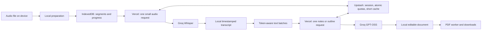

# ProfToPdf

**Turn university lecture recordings into structured, editable notes and a readable PDF.**

ProfToPdf is a mobile-first web application with an Italian interface. It prepares audio on the device, transcribes small segments through Groq, organizes the transcript into chapters, and generates a searchable A4 PDF locally. It is designed for a private study group using **Vercel Hobby, Groq Free and Upstash Redis Free**, without paid API fallbacks or mandatory billing upgrades.

**Status:** private beta. A short recording has completed the production workflow on Samsung S26 / Chrome. A 70-minute recording was fully transcribed, but repeated notes-coverage failures consumed the available daily budget before PDF creation. This revision replaces model-managed citation lists with required per-source content, adds per-lesson token accounting and Screen Wake Lock, and automatically pauses long quota waits. The revised long workflow and Apple devices still require production acceptance testing.

## Capabilities

- Audio selection from the phone or tablet, with drag-and-drop on supported devices.
- A lesson library, editable title, optional subject, and daily quota bars separating used and reserved capacity.
- Local audio preparation, progress by phase, quota countdowns, pause/resume, and IndexedDB persistence.
- Screen Wake Lock during foreground processing and PDF generation, with clear fallback messages and automatic release on pause.
- Timestamped transcript export, structured notes, Markdown editing, chapters, key concepts and a glossary.
- Selectable PDF text, embedded local fonts, page numbers, a contents list, and support for accents and polytonic Greek glyphs.
- Android installation prompt when available; contextual Safari installation instructions shown only on request.
- Confirmed lesson deletion, diagnostic JSON export, and cumulative processing times next to the PDF download.

The application accepts files up to **120 MB / 120 minutes**. These are enforced limits, not a claim that every device and codec combination has passed a two-hour test.

## Architecture



The **original recording never passes through a Vercel Function**. The browser sends independently decodable segments below 3,200,000 bytes; the server validates their actual format and duration before reserving quota. This stays below Vercel's [4.5 MB Function payload limit](https://vercel.com/docs/functions/limitations) without introducing remote audio storage.

The browser runs a sequential queue. Each Function handles one segment or text unit. Short quota waits happen on the device after the Function returns; waits longer than two minutes save the checkpoint and pause for later manual resumption; no background server process is kept alive for the duration of a lecture.

| Component                 | Implementation                                                                              |
| ------------------------- | ------------------------------------------------------------------------------------------- |
| Application               | Next.js App Router, React, TypeScript, Tailwind CSS                                         |
| MP3 / PCM WAV preparation | Incremental TypeScript parsing; no FFmpeg download for standard supported files             |
| Other audio formats       | FFmpeg.wasm, single-thread worker, WORKERFS; remux or bounded per-segment conversion        |
| Speech recognition        | `whisper-large-v3-turbo`; explicit `whisper-large-v3` recovery                              |
| Notes and outline         | `openai/gpt-oss-120b`; allowlisted 20B alternative                                          |
| Token budgeting           | Local `js-tiktoken`, o200k ranks, conservative framing margin and full completion allowance |
| Persistence               | IndexedDB for lessons and text; localStorage for bounded diagnostics                        |
| Coordination              | Upstash Redis, atomic Lua reservations and local cross-tab leases                           |
| PDF                       | PDF-LIB and fontkit in a terminable worker; embedded Noto Sans fonts                        |

## Free-plan operation

Create dedicated **Free** accounts and keep billing upgrades disabled. No credit card is required by the selected free-plan workflow. Provider terms, model access and account limits must be checked when provisioning a new installation. Free plans can change; ProfToPdf stops when capacity or reliable quota tracking is unavailable.

The application deliberately enforces lower limits than Groq's currently published base Free limits:

| Resource           | Application ceiling                               |
| ------------------ | ------------------------------------------------- |
| Speech recognition | 6,600 audio seconds/hour; 27,000 seconds/24 hours |
| Speech requests    | 15/minute; 1,500/24 hours                         |
| Notes tokens       | 6,000/minute; 160,000/24 hours                    |
| Notes requests     | 20/minute; 800/24 hours                           |

These are **shared rolling windows**, not per-student allocations or midnight resets. Overlap, new attempts and processing outside this application consume provider capacity. The quota bars cannot see external calls. A provider 429 introduces a shared cooldown. Groq limits apply at organization level; extra keys in the same organization do not increase capacity. See [Groq rate limits](https://console.groq.com/docs/rate-limits) and [billing information](https://console.groq.com/docs/billing-faqs).

The remaining quota must cover the **whole next reservation**, not merely be greater than zero. A green availability indicator is not a guarantee that an entire lecture fits. No quota is cleared to make a job appear successful.

Atomic reservations use Redis TIME and are reconciled against confirmed provider usage. Text reservations count prompt and schema tokens, add 20% plus 512 tokens for framing/provider differences, and include the entire completion budget, including reasoning. Notes completion caps adapt to source count (1,080–2,400 tokens); outline requests allow 1,100 tokens. This is a conservative tokenizer-based reservation, not a guarantee that arbitrary future provider accounting is identical. Unverified usage and ambiguous failures retain the reservation. SDK retries are disabled.

New notes batches target a reservation of at most **5,500 tokens**, including the repair prompt, and a JSON body below **14 KB**. The server independently enforces its configured quota and 16 KB JSON limit. Do not lower a custom minute allowance without checking that a single batch still fits.

Upstash Free currently advertises 250 MB and 500,000 commands/month. The bounded response cache holds at most 500 results of up to 48 KB, with a 15-minute TTL; Redis stores no audio. Monitor [Upstash usage](https://upstash.com/pricing/redis) and [Vercel Hobby usage](https://vercel.com/docs/plans/hobby) separately. Monthly infrastructure capacity is not represented fully by the application's daily AI bars. Hobby is intended for personal, non-commercial use.

## Setup and deployment

Requirements: **Node.js 22.x**, npm, a Vercel Hobby project with Fluid Compute enabled, Groq Free credentials and an Upstash Free Redis database.

1. For a **new environment**, copy [config/environment.example](config/environment.example) to `.env`. Never overwrite an existing configured `.env`.
2. Supply server-only credentials and an exact HTTPS `APP_ORIGIN`. Use a strong access password and a randomly generated session secret of at least 32 characters.
3. Run the local code checks and production build:

   ```text
   npm ci
   npm run check
   npm test
   npm run build
   ```

4. Add the same environment variables in Vercel. Use **Install: `npm ci`**, **Build: `npm run build`**, **Node: 22.x**, and Fluid Compute. Keep development dependencies available during the build: esbuild generates the PDF worker.
5. Enable `AI_ENABLED=true` only after verifying free-plan status, model access and limits. Deploy through the repository owner's normal Vercel workflow, then perform the production acceptance checks below.

| Variable                                             | Purpose                                              |
| ---------------------------------------------------- | ---------------------------------------------------- |
| `GROQ_API_KEY`                                       | Private Groq credential                              |
| `UPSTASH_REDIS_REST_URL`, `UPSTASH_REDIS_REST_TOKEN` | Private Redis connection                             |
| `SESSION_SECRET`                                     | Session signature secret, minimum 32 characters      |
| `APP_ACCESS_PASSWORD`                                | Shared invitation password, minimum 8 characters     |
| `APP_ORIGIN`                                         | Exact HTTPS origin, without a trailing slash or path |
| `AI_ENABLED`                                         | `false` by default; gates new AI operations          |
| `GROQ_STT_MODEL`, `GROQ_NOTES_MODEL`                 | Allowlisted model selection                          |

The template also lists bounded audio and quota settings. There are no browser-exposed API keys and no required `vercel.json`. AI routes use Node.js, `maxDuration=120`, a shorter upstream timeout, and one operation per invocation.

`prebuild` generates `public/ffmpeg/` and `public/pdf/`; both must stay untracked. Commit their source scripts, the lockfile, and the local font assets instead. WASM is served as `application/wasm`; FFmpeg assets are versioned, and PDF worker/service-worker assets are revalidated. Font downloads are not required during deployment.

On Windows, use `npm.cmd` if PowerShell blocks `npm.ps1`. This workspace follows **Direct-to-Cloud**: local compilation/checks, owner-managed commit/push, then browser testing on the deployed HTTPS origin. Only the repository owner runs Git commands; agents do not start local preview servers.

## Using ProfToPdf

1. Sign in and choose **Nuova lezione** from **Le tue lezioni**. Select a recording, enter a useful title, optionally choose or type a subject, and press **Prepara la lezione**.
2. When segmentation finishes, press **Trascrivi e crea il Pdf**. Keep the application visible. Where supported, the screen stays awake automatically. Progress and quota waits appear in the processing panel; confirmed results are saved after every unit.
3. Review the transcript and notes. Edit the Markdown if needed, save it, and press **Prepara PDF**. Download or open the generated file in the device's PDF viewer.
4. Export important material before deleting a lesson or clearing browser storage. Deletion requires confirmation and interrupts local processing; an already submitted provider request can still consume quota.

The first PDF line contains **Subject - dd/mm/yyyy**, followed by the lesson title on the next line. The filename uses `Subject - Title - dd-mm-yyyy.pdf`, omitting an empty subject. Slashes are replaced with hyphens for filesystem compatibility. Dates use Europe/Rome. PDF regeneration requires confirmation when an earlier export is recorded; changing saved notes permits a new version.

Android installation uses the native browser prompt when it becomes available. Safari instructions open after tapping **Installa ProfToPdf**. Installed/standalone detection hides the control; Safari's manual **Ho aggiunto l’app alla Home** confirmation handles the normal-tab detection limitation. Installation does not enable offline AI or background processing. Apple may keep the installed app's storage separate from Safari.

## Recovery and error handling

Use **Riprendi / recupera il risultato** on the same device and browser. Confirmed transcripts and notes are reused. A saved batch plan keeps operation IDs stable across reloads; upgrades preserve confirmed legacy notes and the legacy operation being repaired.

The notes response has a **required object entry for every source**. The model supplies that source's paragraphs, bullets and concepts; each entry must contain nonblank substantive content. The application assembles one section per batch and attaches source references only after checking every entry. Missing or empty entries remain errors. Speech-uncertainty warnings are added deterministically. This removes repeated failures caused by omitted citation IDs without accepting absent content or claiming that schema compliance proves academic accuracy.

Definitively invalid notes still receive a corrective attempt within **three total attempts per operation**, with each attempt persisted and quota-reserved. Prompt/schema changes resize only untouched work and locally quota-denied operations that never started. Confirmed notes and ambiguous operations keep their IDs and are not regenerated.

After exhausted coverage/JSON attempts, or immediately for a truncated completion, a batch containing multiple sources can be split **once into two smaller operations**. The split and child IDs are saved before requests start, confirmed notes are preserved, and children cannot split recursively. Each child has its own quota-reserved attempts; the three-attempt ceiling applies per operation, not to the entire original group. A single-source failure or an unsuccessful child stops visibly. Provider JSON-generation failures are distinguished from rejected audio.

Network ambiguity follows a different path: the application retrieves the **same operation** rather than silently launching another inference. If the result remains unavailable, a new attempt requires an explicit user action. The 15-minute cache and idempotency controls do not provide an unconditional exactly-once guarantee after lost responses or cache expiry.

Quota waits up to two minutes resume automatically while the screen lock remains active. Longer waits checkpoint the job, show the retry date/time and pause; the screen lock is released and the app can be closed. Sign in again if needed and resume on the same device/browser after capacity returns. This does not refund earlier consumption or guarantee capacity if another request uses it first.

[Screen Wake Lock](https://developer.mozilla.org/en-US/docs/Web/API/Screen_Wake_Lock_API) requires HTTPS and a visible active page. The app requests it during audio/AI work and PDF rendering, releases it on stop/cleanup, and reacquires it on return to visibility when work is still active. Feature detection, rejection and OS revocation are logged. Power saving, low battery and operating-system policies may deny or revoke it; manual locking or switching apps can still suspend processing. The UI reports when the lock is unavailable.

Whisper V3 recovery is explicit and shares the speech budget. Skipping a failed segment is also explicit: it remains a visible gap, the document is marked partial, and the segment can be recovered later.

The exported **checkpoint contains audio metadata only**. It does not contain audio blobs, transcript or notes, and is not a complete backup. Use transcript TXT, notes Markdown and PDF exports for portable results. Original audio may be required to rebuild missing local chunks. Logout does not erase the local lesson library.

## Diagnostics and timing

**Scarica log diagnostico** exports a JSON report containing client revision, browser/device details, technical progress events, quota waits, error codes and safe validation diagnostics. For example, an invalid field can identify `sections.0.paragraphs` and the expected type without copying the model's response. Coverage failures report separate counts and numeric paths for missing sources, empty citation lists and unknown references; unexpected ID values are excluded. `notes.split` records bounded recovery, and `notes.saved` includes source/uncertainty counts. `inference.usage` records reserved and confirmed token counts; quota errors identify the blocking window and required/residual capacity. `quota.long-pause` records a saved long wait; `wake.*` events record lock acquisition, denial and release.

Logs exclude credentials, cookies, recording contents, transcript text, titles and filenames. They are never uploaded automatically. Retention is five lessons and 200 events per lesson, with an additional size bound; `droppedEvents` records trimming. The current client revision is `notes-sources-wake-2026-10-17-v6`. Console events use `[ProfToPdf audio]`.

Exports also contain `aiUsageSummary`: `confirmedTokens`, `reservedUnverifiedTokens`, `trackedOperations` and `historyComplete`. The per-operation ledger lives with the IndexedDB lesson and survives event trimming; cache replay of the same operation/attempt does not count twice. Old lessons are explicitly marked as incomplete history because earlier token usage cannot be reconstructed reliably.

Every export ends with `timingSummary`:

```json
{
  "tempoTotaleSecondi": 153.1,
  "tempoTotaleFormattato": "2m 33s",
  "preparazioneAudioSecondi": 3.3,
  "trascrizioneAppuntiSecondi": 146.3,
  "generazionePdfSecondi": 3.5,
  "completo": true,
  "inCorso": false
}
```

This example illustrates the format, not a 70-minute performance promise. Totals include quota waits during active processing, failed attempts and subsequent PDF regeneration. They exclude manual gaps between commands, paused intervals (including automatic long-quota pauses) and time with the page closed. Thus it measures cumulative processing activity, not calendar time from the first click to the eventual download; a 12-hour quota pause remains a 12-hour practical delay. Timing counters survive event trimming; incomplete historical evidence is labelled partial. Export the diagnostic log before retrying after a failure.

## Validation

As of **17 October 2026**, the automated suite contains **85 passing tests**. Regressions cover saved long transcripts/notes, bounded repairs, missing/blank source entries, unknown-reference privacy, quota pause/resume, token accounting, and wake-lock acquisition, visibility, cleanup, denial and revocation, alongside audio, session, storage and PDF checks.

| Evidence                         | Verified                                                                                                                                                   | Still required                                                                      |
| -------------------------------- | ---------------------------------------------------------------------------------------------------------------------------------------------------------- | ----------------------------------------------------------------------------------- |
| Samsung S26 / Chrome, production | Login/session; short lecture to PDF; 33/33 long transcripts; v5 progressed further but reached a daily notes quota wait after 37m 9s cumulative processing | v6 long PDF, fidelity review and actual duration/cost                               |
| Local checks                     | Unit tests, TypeScript/configuration/credential checks, production compilation                                                                             | Mobile runtime behavior                                                             |
| Real Groq + Redis integration    | v6: two synthetic physics sources, one uncertain; complete content map, one section, 1,170 confirmed tokens, cache replay without additional consumption   | A full long lecture under the new contract; these were text probes, not audio tests |
| PDF worker                       | Earlier synthetic 13-page visual verification including polytonic Greek                                                                                    | Actual long PDF; Apple download/opening                                             |
| Apple devices                    | Implementation and non-browser checks                                                                                                                      | Safari, M4A/AAC, install, wake lock, suspension, reload and downloads               |
| Capacity                         | Synthetic 70-minute batching benchmark: 20–21 notes calls + one outline, 106,540–117,344 total maximum reservations                                        | Real 70-minute completion, two-hour/90 MB devices and monthly hosting/Redis usage   |

The synthetic timing model allows 230 seconds for preparation/transcription, 60 seconds per notes/outline request including short quota waits, and 12 seconds for PDF: **25–26 minutes** across 5,600–9,800 words. A practical estimate is **25–30 minutes**, conditional on sufficient starting capacity, successful outputs and a visible active page. It is not a measured long-audio result or a guarantee; retries, dense material, slow networks or pre-used quota can exceed 30 minutes. The existing job has already consumed its earlier budget and must wait for rolling capacity to return.

Useful commands:

| Command                           | Effect                                                                                                                      |
| --------------------------------- | --------------------------------------------------------------------------------------------------------------------------- |
| `npm run check`                   | TypeScript, environment validation and credential/exclusion checks                                                          |
| `npm test`                        | Local automated suite; no provider calls                                                                                    |
| `npm run build`                   | Production build and generated assets                                                                                       |
| `npm run benchmark:notes`         | Synthetic 70-minute text batch counts; local only                                                                           |
| `npm run inspect:quota`           | Read-only live application quota audit, aggregated without operation IDs; no provider inference                             |
| `npm run verify:source-contract`  | **Uses real Groq/Redis quota:** one small two-source text request and cache replay, with capacity preflight                 |
| `npm run verify:notes`            | **Uses real Groq/Redis quota:** diverse synthetic physics sources, uncertainty, bounded splitting, outline and cache replay |
| `npm run verify:processing`       | **Uses real Groq/Redis quota:** requires a locally supplied short synthetic spoken WAV                                      |
| `npm run verify:audio-validation` | Native FFmpeg format validation with generated tones                                                                        |
| `npm run verify:pdf`              | Synthetic PDF worker verification; no browser or API                                                                        |

Cloud checks require a configured private `.env`. Do not repeatedly consume quota for already-passing checks. Test outputs and the operational plan remain local and excluded; this README contains the public setup and acceptance instructions.

## Production acceptance checks

1. Deploy the revision, reload the HTTPS application, sign in and inspect remaining quotas. After starting/resuming processing, confirm the new diagnostic revision above; a previously exported log retains its older revision.
2. **Resume the existing long lesson first when quota is sufficient.** The 33 saved transcripts and confirmed notes are reused. The old quota-denied unit may be resized to the new schema budget; ambiguous operations remain unchanged. Confirm the new revision, `wake.held` (or a specific fallback), `inference.usage`, successful PDF download and the exported log. Do not clear browser storage or create a fresh copy just to bypass a quota wait. A saved future retry date can immediately pause again without another AI call.
3. For a separate full-duration measurement, create a **new lesson from the original recording** only with sufficient unused capacity (the synthetic maximum-reservation benchmark needs roughly 107–117k tokens before a retry margin). Avoid manual pauses, export the log and review the complete transcript/PDF. The resumed job's cumulative time includes its earlier failures and has incomplete historical token accounting.
4. Test pause/reload/resume, loss of network, short automatic quota waits, long saved quota pauses, wake-lock release on pause/completion, two-tab ownership and deletion during active work. Deleted lessons must not return after a late response.
5. On iPhone/iPad, test Safari and installation separately with a short M4A first, then the long recording. Check file selection, WASM loading, background suspension, local storage and PDF download/opening.
6. Compare short mixed Italian/English, Latin and school Ancient Greek samples against the source. Finally test the two-hour/90 MB boundary and review infrastructure dashboards.

## Limitations and release readiness

- **Foreground operation is required.** A browser or operating system may suspend or discard the page; keep originals and exported results.
- Free capacity is finite and shared. A two-hour recording exceeds the application's conservative hourly speech allowance before overlap, so an hour-scale quota wait is possible even from an initially unused account. No fixed completion time is guaranteed.
- New lessons use automatic speech-language detection and language-preserving notes prompts. Existing Italian-only jobs retain their original recognition settings for safe replay. Ancient Greek and school Latin recognition are not guaranteed; notes cannot reliably repair words already transcribed incorrectly.
- Mathematical expressions are retained as text. The PDF renderer does not typeset LaTeX or interpret remote HTML/resources. An unsupported glyph produces an explicit error.
- The library belongs to the browser profile, not a cloud account. There is no cross-device sync, complete checkpoint backup, public registration or reliable closed-page processing.
- Apple acceptance, long-document fidelity, two-hour capacity and the latest production smoke test remain release work. Public access would also require a deliberate capacity and account-management design.

## Privacy and security

Audio segments and text batches are sent to Groq only after processing is started. Original files, saved lessons and PDFs remain on the device; small results are cached briefly in Redis for response recovery. Hosting and provider processing still occur remotely. See [Groq data handling](https://console.groq.com/docs/your-data) for provider policy; local deletion does not assert deletion of provider-side records.

Sessions use a signed, revocable `__Host-` cookie with Secure, HttpOnly and SameSite=Strict, an eight-hour absolute lifetime, exact Origin checks and CSRF protection for mutations. Login and inference routes are rate-limited. Shared counters fail closed if Redis is unavailable. The service worker is network-only and does not cache private pages, API responses or recordings.

Never commit `.env` variants, credentials, private recordings or diagnostic reports. `Documenti/`, `docs/`, build outputs and generated workers stay ignored. Report a vulnerability privately to the repository owner without attaching secrets or lecture content to a public issue.

## Project layout

```text
config/environment.example   Safe environment template
src/app/api/                  Session, quota, transcription, notes and cleanup routes
src/components/               Library, upload, installation, quota and document UI
src/lib/audio/                Incremental parsers, FFmpeg bridge, diagnostics and timing
src/lib/pipeline/             Resumable preparation and AI orchestration
src/lib/notes/                Token budgets, batching, prompts, validation and assembly
src/lib/pdf/                  Local PDF renderer and worker bridge
src/lib/server/               Authentication, atomic quotas and bounded result cache
src/lib/storage/              IndexedDB jobs, chunks and leases
src/workers/                  Browser worker entry points
public/fonts/                 Local Noto Sans fonts and their license
scripts/                      Build preparation, checks and focused verification
tests/unit/                   Automated regression tests
```

## Licensing

The project does not currently declare an application software license. Publication alone does not grant reuse rights; the owner should select and add a license before presenting it as open-source software. Noto Sans font licensing is included in [public/fonts/OFL-NotoSans.txt](public/fonts/OFL-NotoSans.txt). Dependencies retain their respective licenses.
